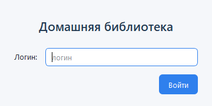
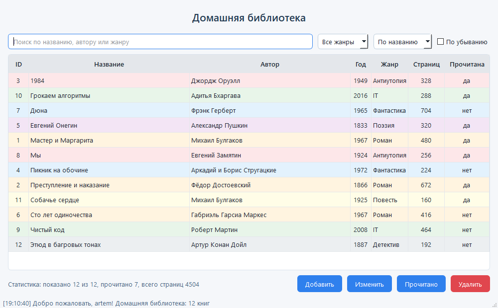

# Домашняя библиотека

Программа для учёта книг на PyQt6. Можно добавлять, редактировать и удалять книги, искать по названию или автору, фильтровать по жанру и сортировать. Книги сохраняются в `data/books.csv`.

При закрытии программы в `report.txt` записывается, кто и когда работал с приложением.

## Скриншоты

Окно входа:

Главное окно:

## Запуск

Нужен Python 3.8 или новее.

РАЗАРХИВИРОВАТЬ И ЗАПУСТИТЬ `run.bat`. НЕ ЗАКРЫВАТЬ ПОЯВИВШЕЕСЯ ОКНО

## Горячие клавиши

- Ctrl+F - поиск
- Ctrl+N - добавить книгу
- Enter / двойной клик - редактировать
- Пробел - отметить прочитанной
- Delete - удалить
